# Ang Gastos!

**Ang Gastos!** is a money notebook. You write down your income and your spending. The app adds them up for every month.

"Gastos" means "spending" in Filipino.

> This app is still growing. It is built in 6 steps (see [docs/PLAN.md](docs/PLAN.md)). Steps 1 to 5 are done: login, the demo, the database, entries, wallets, categories, the dashboard, reports, budgets, repeating entries and CSV files.

## Screenshots

| Screen | Picture |
|---|---|
| **Log in.** Log in with your name and password. Or press "Try the demo". | 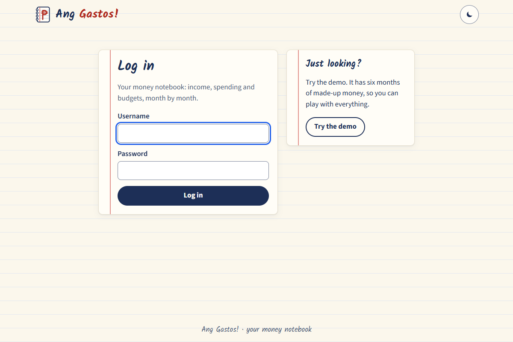 |
| **Dashboard.** One month at a glance: money in, money out, what is left, and the money in your wallets. Small arrows show the change since last month. A bar for each category shows where your money goes. A line shows your spending day by day, next to last month. Columns show the last 12 months. | 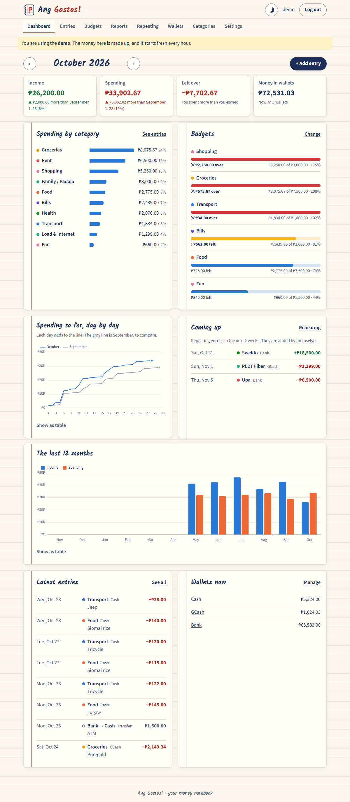 |
| **Dark mode.** Press the moon button. The page turns dark. | 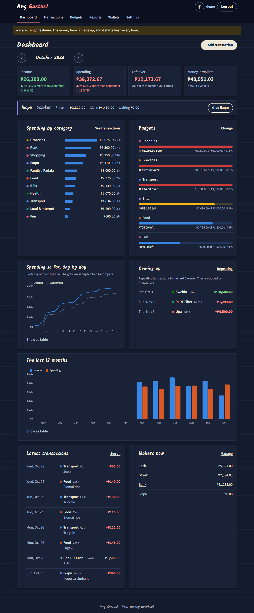 |
| **Phone.** The app works on small screens too. | 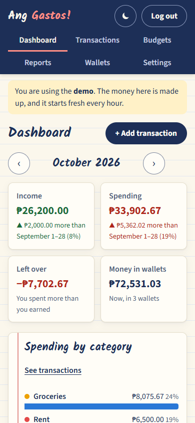 |
| **Entries.** All your income and spending for one month. Use the arrows for other months. Search and filter by type, category or wallet. | 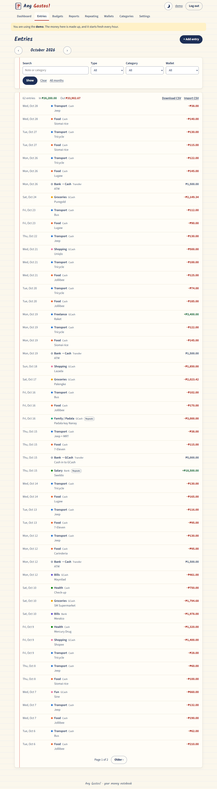 |
| **Add an entry.** Choose Spending, Income or Transfer. Type the amount, the date, the wallet and the category. | 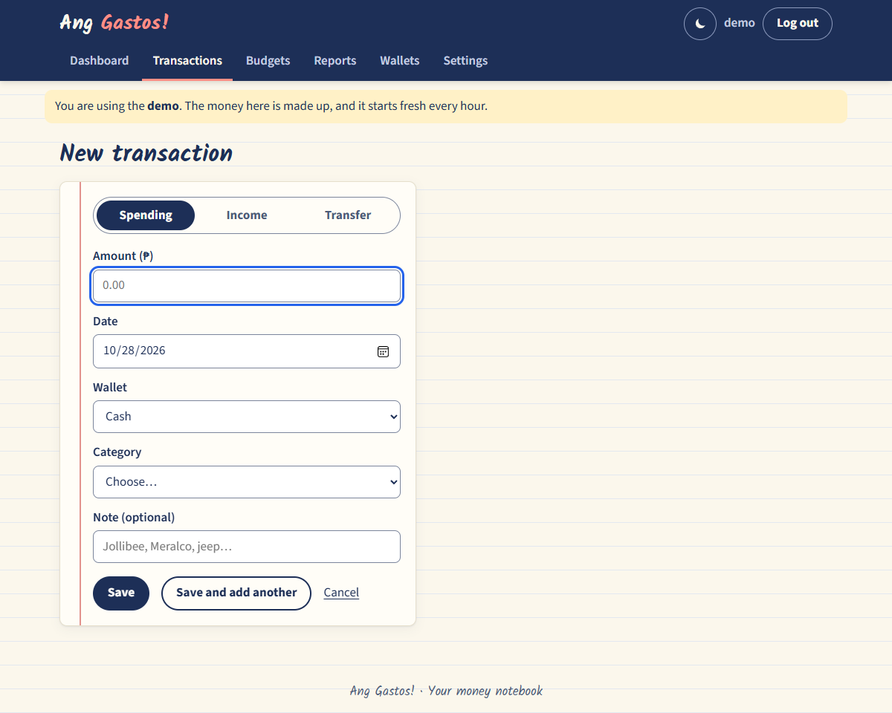 |
| **Wallets.** Where is your money? Cash, GCash, the bank. You see how much is in each one. | 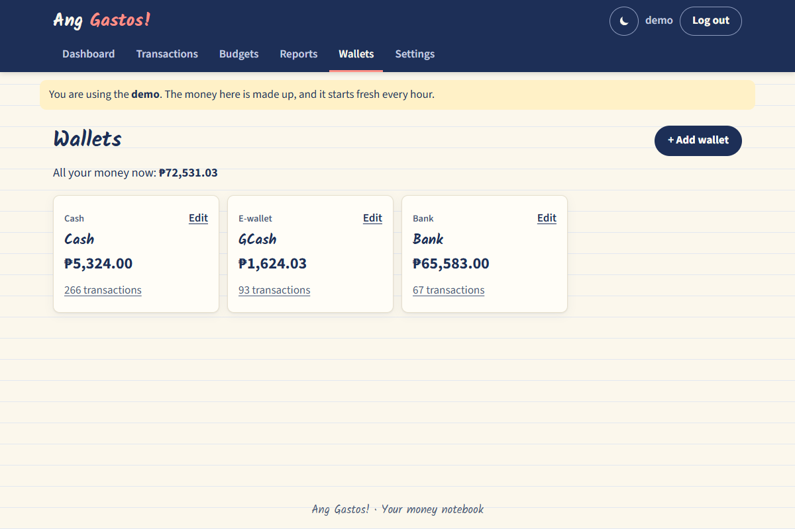 |
| **Categories.** Food, Rent, Salary... Each one has a colour. You can add your own. | 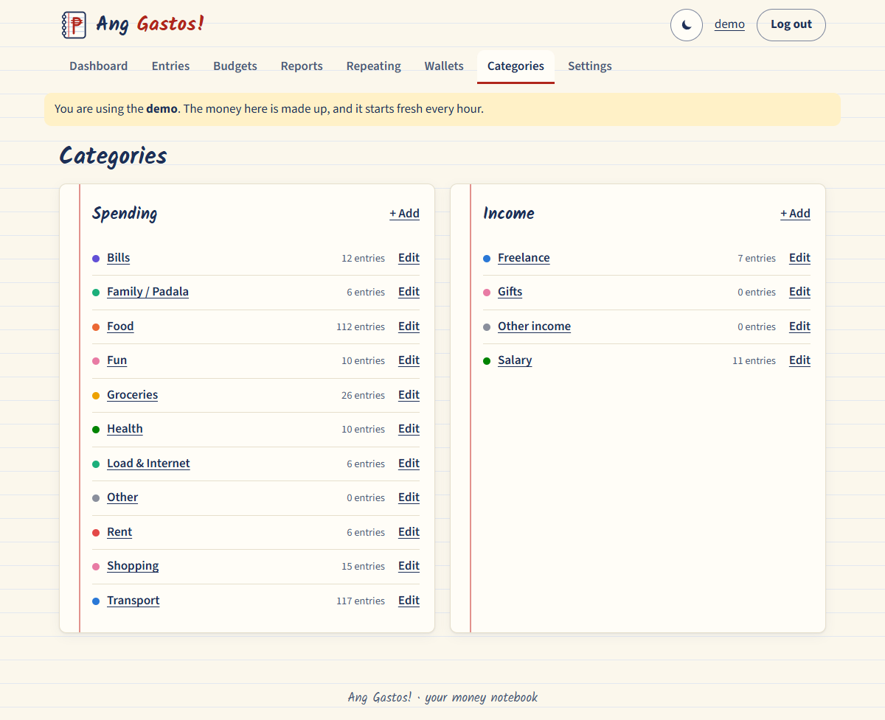 |
| **Budgets.** Set a limit for a category, like ₱3,500 for Food. The bar turns yellow at 80% and red when you go over. "Copy September's budgets" fills a new month for you. | 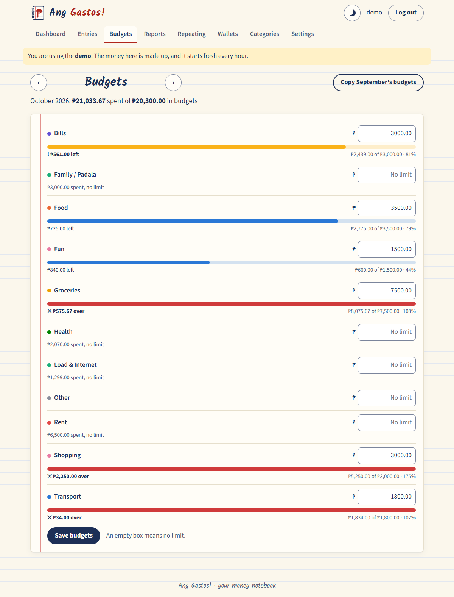 |
| **Repeating.** Salary, rent, internet... Write them once. The app adds them every month on their day. | 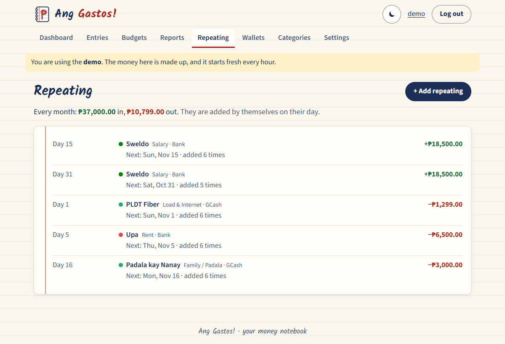 |
| **CSV files.** Upload a table from Excel or Google Sheets. First you see a check: good rows, rows with problems, new names, and rows you already have. Then you press "Add the entries". | 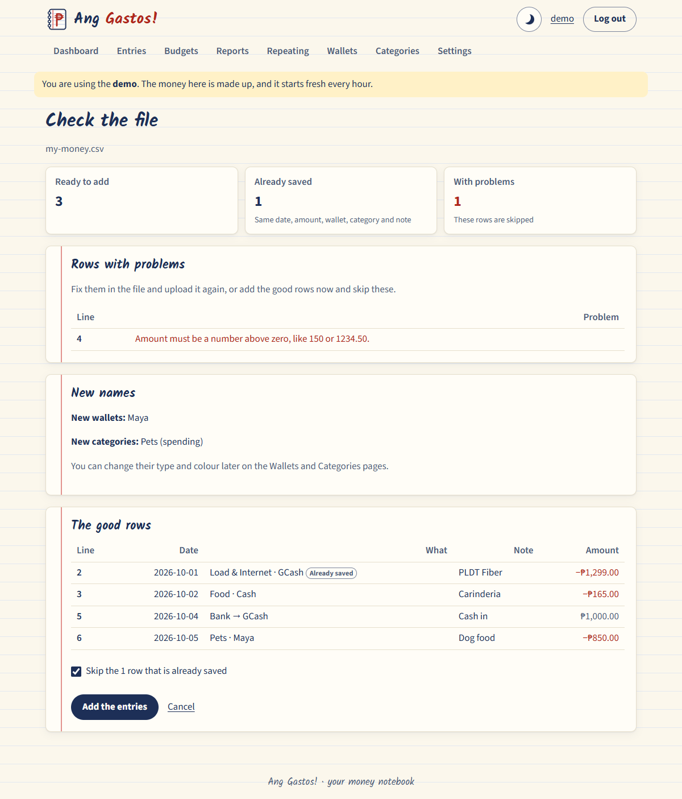 |
| **Reports.** One year at a time. A table for every month, and a table for every category and month: darker boxes mean more money. You also see your biggest spending. | 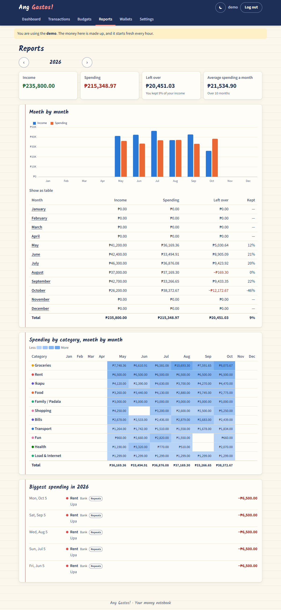 |
| **Entries on a phone, dark mode.** | 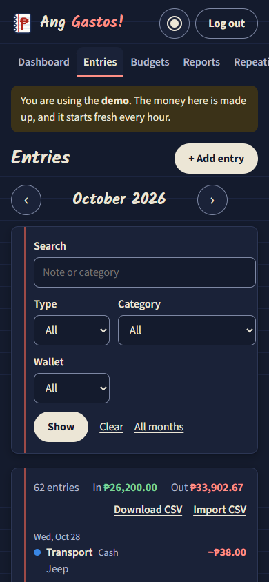 |

## What can it do?

- **Log in.** Only you can see your money.
- **Try the demo.** The demo has 6 months of made-up money. Anyone can use it. It starts fresh every hour.
- **Dashboard.** Pick a month. See income (green), spending (red), money left over, and how much of your income you kept. Is it more or less than last month? (For this month, it compares the same days: October 1–28 with September 1–28.)
- **Charts.** Spending by category, spending day by day, and the last 12 months. Press **Show as table** to see the same numbers in a table.
- **Budgets.** A limit for each category, each month. The dashboard shows which budgets are almost used up or over.
- **Repeating entries.** For money that comes or goes every month. Choose the day (1 to 31). Day 31 means the last day in short months. If you don't open the app for a while, the missed months are added when you come back. If you delete one of these entries (you skipped a month), it doesn't come back.
- **CSV files.** Download your entries (all, one month, or just what the Entries page shows) and open them in Excel. Or add many entries from a CSV file. The columns are: `date, type, amount, wallet, to_wallet, category, note`.
- **Reports.** A whole year: totals, the average spending a month, a category-by-month table, and your 5 biggest spendings.
- **Write down entries.** Spending, income, or a **transfer** (money from one wallet to another, like an ATM withdrawal). Change or delete them later.
- **Find entries.** Go month by month. Search a word. Show only one type, category or wallet.
- **Wallets.** Cash, GCash, Bank, or your own. The app adds up the money in each one.
- **Categories.** Use ours or make your own, with a colour.
- **Archive.** A wallet or category with entries can't be deleted. You can archive it: the old entries stay, but you can't pick it for new ones.
- **Light or dark.** Press the moon or sun button.

Coming next: the live website.

## How to run it on your computer

You need Python 3.13.

1. Make a virtual environment and install the parts:

   ```
   python -m venv .venv
   .venv\Scripts\python -m pip install -r requirements.txt
   ```

2. Make the database (only the first time):

   ```
   .venv\Scripts\flask --app gastos init-db
   ```

3. Make your login. The app asks for a password two times:

   ```
   .venv\Scripts\flask --app gastos create-user juan
   ```

4. Start the app:

   ```
   .venv\Scripts\flask --app gastos run --debug --port 5002
   ```

5. Open http://127.0.0.1:5002 in your browser.

Did you forget your password? Run `.venv\Scripts\flask --app gastos set-password juan`.

## How to run the tests

```
.venv\Scripts\python -m pytest
```

## Tools we use

| Tool | What it is | What it does here |
|---|---|---|
| Python | A programming language | All the app's code |
| Flask | A small web framework for Python | Makes the pages and the login |
| SQL | The language of databases | Saves your money data and adds it up |
| SQLite | A small database in one file | Keeps your data on your computer |
| PostgreSQL (Neon) | A big database on the internet | Will keep your data on the live website |
| Jinja | HTML templates | Puts your data into the pages |
| HTML and CSS | The language of web pages | The look: a notebook with lines |
| JavaScript | A language for web pages | The light/dark button and the charts |
| Chart.js | A JavaScript library for charts | Draws the line and column charts |
| pytest | A test tool for Python | Checks that the code works |
| GitHub | A website for code | Keeps the code and its history |
